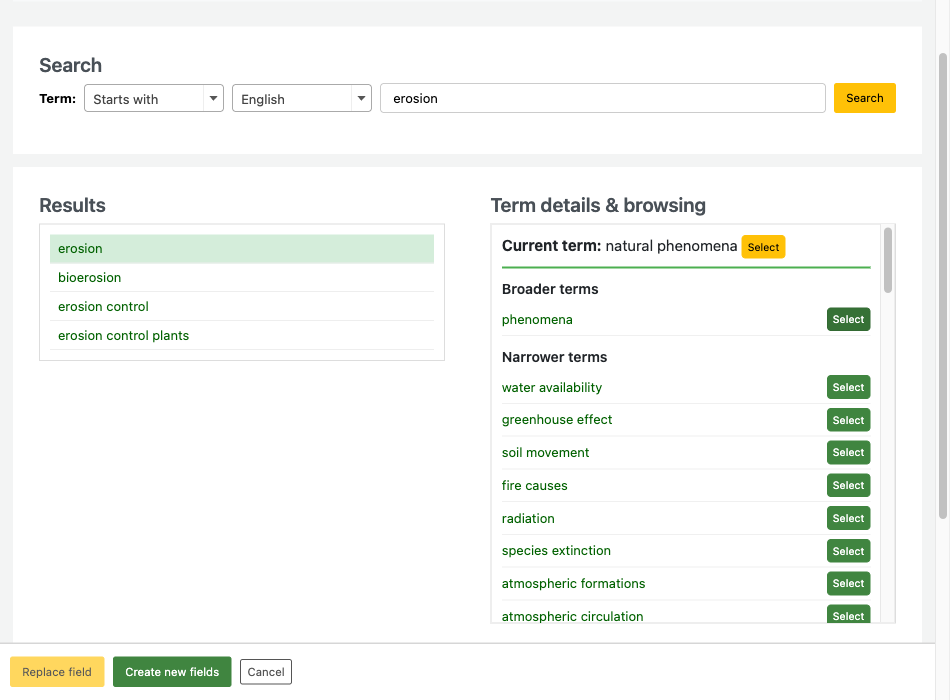

# Koha AGROVOC Value Builder Plugin

A Koha plugin that gives cataloguers a value builder for the FAO AGROVOC
thesaurus. Search AGROVOC, browse concept relationships, and write the selected
terms into MARC21 subject fields with the correct subfields and indicators.



This branch redesigns the popup to use the Koha staff interface styling. The
`main` branch is a faithful port of the in-tree `marc21_field_650_agrovoc.pl`
value builder, with its original popup. Compare the two before you choose one.

## Features

- Search AGROVOC with three match types: starts with, exact match, contains.
- Browse broader, narrower, and related terms, and click any of them to browse on.
- Multi-language terms: English, French, and Spanish.
- Two workflows: replace the current field, or create one field per selected term.
- MARC21 output with the correct source code and second indicator.
- Koha staff interface styling, Bootstrap and Select2 based.

## Requirements

- **Koha 24.11 or later**
- **Bug 39522** - Add hooks to allow 'Valuebuilder' plugins to be installable
  - Bug URL: https://bugs.koha-community.org/bugzilla3/show_bug.cgi?id=39522
  - Without this bug, Koha cannot install a value builder as a plugin.
- Outbound HTTPS access from the Koha server to `agrovoc.fao.org`.

## Installation

1. Download the `.kpz` file from the
   [latest release](https://github.com/openfifth/koha-plugin-agrovoc-value-builder/releases).
2. Go to Administration > Manage plugins in the staff interface.
3. Upload the `.kpz` file.
4. Enable the plugin.

## Usage

### Setup in the MARC bibliographic framework

1. Go to Administration > MARC bibliographic framework.
2. Choose your framework. Click "MARC structure".
3. Edit subfield `$a` of field **650** or **651**.
4. Set **Plugin** to `agrovoc`.
5. Save the subfield.

Subfield `$a` must have no authority type set. Koha checks the authority link
first, so a subfield with an authority type never reaches its value builder.

### Cataloguing with the plugin

1. Open the record editor. Go to field 650 or 651.
2. Click the plugin button next to subfield `$a`. The AGROVOC popup opens.
3. Enter a term. Choose a match type and a language. Click "Search".
4. Click a result to see its broader, narrower, and related terms.
5. Click any of those terms to browse on from that term.
6. Click "Select" to add a term to your selection.
7. Finish with one of the two buttons:
   - **Replace field** writes the one selected term into the current field.
   - **Create new fields** clones the field once for each selected term.

### MARC21 field population

The plugin writes these values into each field:

| Target | Value |
| --- | --- |
| `$a` | Preferred label |
| `$0` | AGROVOC concept URI |
| `$9` | Concept identifier, taken from the end of the URI |
| `$2` | Source code for the search language |
| Indicator 2 | `7` |

The source code in `$2` follows the search language:

| Language | `$2` |
| --- | --- |
| English | `agrovoc` |
| French | `agrovocf` |
| Spanish | `agrovocs` |

Example output:

```
650 _7 $a soil erosion $0 http://aims.fao.org/aos/agrovoc/c_7168 $2 agrovoc $9 7168
```

### A warning about `$9`

Koha reserves `$9` in a bibliographic field for the record number of a linked
**Koha authority record**. It reads `$9` to build the subject link, it indexes
the value as the `an` search index, and it uses that index to find the records
to rewrite when an authority is edited or merged.

An AGROVOC identifier in `$9` therefore collides with an unrelated Koha
authority number. Three things follow:

1. The subject links to an authority-number search instead of a term search.
2. The value is searchable as if it were a Koha authority id.
3. Editing or merging the Koha authority with that number rewrites the heading
   and `$2` of the AGROVOC field, so the term is lost without warning.

Not every AGROVOC identifier is numeric either, so `$9` can receive a value
Koha cannot read as a record number at all.

Both branches write `$9`, to match the in-tree value builder. Remove the `$9`
branch from `applyTerm` in `agrovoc_search.js` if you would rather not carry
the risk. The identifier is also inside the `$0` URI, with its namespace
attached.

## API integration

The plugin proxies two Skosmos REST endpoints at `https://agrovoc.fao.org/browse/rest/v1`:

- `GET /search?query={term}&lang={lang}` for the result list.
- `GET /{vocid}/{type}?uri={uri}&lang={lang}` for broader, narrower, and related concepts.

The browser never calls AGROVOC directly. Koha makes the request, so the plugin
works where the staff browser has no outbound internet access.

## Development

### Version management

```bash
npm run version:patch   # 1.0.0 -> 1.0.1
npm run version:minor   # 1.0.0 -> 1.1.0
npm run version:major   # 1.0.0 -> 2.0.0
```

Each bump updates `package.json`, the `$VERSION` and `date_updated` in the
plugin module, and promotes the `[Unreleased]` section of `CHANGELOG.md`.

### Releases

```bash
npm run release:patch
```

This bumps the version, commits, tags, re-enables dormant GitHub Actions
workflows, and pushes. The CI workflow then tests against Koha main, stable, and
oldstable, builds the `.kpz`, and publishes a GitHub release.

### Tests

```bash
KOHA_PLUGIN_DIR=$(pwd) PERL5LIB=$PERL5LIB:. prove -v t/
```

Run the command inside a Koha environment, such as koha-testing-docker.

## License

GPL-3.0
